# ScholarTrack — Scholarship & Fellowship Deadline Tracker

> **Integrated Academic Technology Platform**  
> *Domain:* Educational Funding, Fellowships & Application Deadline Tracking  
> *Architecture:* Python 3.14 &bull; Flask &bull; SQLAlchemy &bull; BeautifulSoup4 &bull; APScheduler &bull; Bootstrap 5 &bull; Chart.js  

---

## 1. Project Overview & Problem Statement

Funding announcements for university scholarships, postdoctoral fellowships, and research grants are widely scattered across university departments, government councils, and private foundations. Students and research scholars face critical obstacles:
- **Scattered Information:** Prospective candidates must check dozens of individual sites with inconsistent layouts.
- **Unannounced Deadline Extensions & Revisions:** Funding bodies frequently revise submission deadlines, funding benefits, or prerequisite criteria without broad notice.
- **Timezone Inconsistencies:** Midnight deadlines across different timezones (UTC, CET, EST, GMT, PST) cause accidental missed deadlines.
- **Fabricated Dates in General Trackers:** Common web aggregators often convert rolling or open application windows into arbitrary dates, misleading students.

**ScholarTrack** solves this challenge by serving as an integrated, transparent, source-verified tracking platform. It systematically collects publicly available announcements from approved sources, normalizes details without inventing missing information, calculates deadlines using explicit timezones, detects changes via cryptographic hashing, and provides personalized tracking with automated alerts.

> **Responsible Data Use Notice:**  
> ScholarTrack displays published eligibility information for students to review. ScholarTrack **never** claims that the application determines a student's final eligibility. Always review the original official announcement before submitting an application.

---

## 2. Technology Stack

- **Backend:** Python 3.14, Flask 3.1.x
- **Database & ORM:** SQLite with SQLAlchemy (Flask-SQLAlchemy)
- **Web Scraping:** Requests, BeautifulSoup4 (`html.parser`), `urllib.robotparser`
- **Data Normalization & Processing:** Pandas, Python standard library, python-dateutil
- **Authentication & Security:** Flask-Login, Werkzeug password hashing (PBKDF2/scrypt), Flask-WTF CSRF protection
- **Background Scheduling:** APScheduler (`BackgroundScheduler`)
- **Frontend & UI:** HTML5, CSS3, JavaScript, Bootstrap 5.3, Bootstrap Icons
- **Interactive Visualizations:** Chart.js
- **Configuration Management:** python-dotenv (`.env`)
- **Automated Testing:** pytest (26 comprehensive test cases)

---

## 3. System Architecture & Data Flow

```mermaid
flowchart TD
    subgraph Sources["Approved Public Sources"]
        S1["University Scholarship Portals\n(Card Layout)"]
        S2["Research Grants Boards\n(Table Layout)"]
    end

    subgraph Pipeline["Scraping & Verification Pipeline"]
        SEC["SSRF Security Checker\n(Approved Host Allowlists)"]
        ROB["Robots.txt Checker"]
        FET["Polite Fetcher\n(Timeout & Exponential Backoff)"]
        ADP["Adapter Registry\n(UniversityPortalAdapter / ResearchGrantsAdapter)"]
        NORM["Normalizer\n(Strict Unknown Deadlines, Level & Discipline)"]
        HASH["Content Hasher (SHA-256)"]
        CD["Change Detector\n(Deadline, Benefit, Eligibility, Withdrawal)"]
    end

    subgraph DB["Relational Database (SQLite)"]
        M1["Users (Student / Admin)"]
        M2["Sources"]
        M3["ScholarshipNotice"]
        M4["NoticeHistory"]
        M5["ScrapeJob"]
        M6["SavedScholarship"]
        M7["UserAlert"]
    end

    subgraph Views["User Interfaces"]
        PUB["Public Landing & Explore Listings\n(Search, Filter, Detail)"]
        STU["Student Dashboard & Tracker\n(Saved Grants, Alerts, Profile)"]
        ADM["Admin Management Dashboard\n(Source Control, Job Audits, Chart.js)"]
    end

    Sources --> SEC --> ROB --> FET --> ADP --> NORM --> HASH --> CD
    CD --> DB
    DB --> Views
```



---

## 4. Database Schema

The database model is defined in `models.py` using SQLAlchemy:

1. **`users` (`User`)**:
   - `id`: Integer Primary Key
   - `email`: String(120), Unique, Indexed
   - `password_hash`: String(255) (PBKDF2/scrypt secure hash)
   - `full_name`: String(100)
   - `role`: String(20) (`student` or `admin`)
   - `created_at`, `updated_at`: DateTime (UTC)

2. **`sources` (`Source`)**:
   - `id`: Integer Primary Key
   - `name`: String(120), `code`: String(50, Unique)
   - `base_url`, `listing_url`: String(255)
   - `adapter_name`: String(50) (`university_portal`, `research_grants`)
   - `is_enabled`: Boolean (Default True)
   - `request_interval_minutes`: Integer (Default 60)
   - `last_checked_at`, `last_success_at`: DateTime
   - `status`: String(20) (`active`, `degraded`, `failing`, `disabled`)

3. **`scholarship_notices` (`ScholarshipNotice`)**:
   - `id`: Integer Primary Key
   - `notice_id`: String(64, Unique, Indexed) (Stable slug)
   - `source_id`: ForeignKey (`sources.id`)
   - `url`: String(500) (Original official announcement URL)
   - `notice_type`: String(50) (Scholarship, Fellowship, Grant)
   - `title`, `provider`: String(255)
   - `education_level`: String(50) (Undergraduate, Postgraduate/Master, PhD / Doctoral, Postdoctoral)
   - `discipline`: String(100) (Computer Science & AI, Engineering, Health & Medicine, etc.)
   - `region`: String(100)
   - `benefit_text`, `eligibility_excerpt`: Text
   - `due_at`: DateTime (Strictly `None` if rolling/unknown)
   - `timezone`: String(20) (UTC, CET, EST, GMT, etc.)
   - `content_hash`: String(64) (SHA-256)
   - `notice_status`: String(30) (`active`, `updated`, `withdrawn`)
   - `previous_deadline`, `updated_deadline`: DateTime
   - `is_verified`: Boolean, `is_featured`: Boolean

4. **`notice_history` (`NoticeHistory`)**:
   - `id`: Integer Primary Key
   - `notice_id`: ForeignKey (`scholarship_notices.id`)
   - `change_type`: String(50) (`deadline_extension`, `deadline_shortened`, `eligibility_modified`, `benefit_updated`, `notice_withdrawn`)
   - `field_changed`: String(50)
   - `old_value`, `new_value`: Text
   - `detected_at`: DateTime (UTC)
   - `source_evidence_url`: String(500)

5. **`scrape_jobs` (`ScrapeJob`)**:
   - `id`: Integer Primary Key
   - `source_id`: ForeignKey (`sources.id`, Nullable)
   - `status`: String(20) (`running`, `completed`, `failed`)
   - `started_at`, `finished_at`: DateTime
   - `records_found`, `records_added`, `records_updated`, `revisions_detected`: Integer
   - `http_status`: Integer
   - `execution_time_ms`: Integer
   - `error_message`, `log_excerpt`: Text

6. **`saved_scholarships` (`SavedScholarship`)**:
   - `id`: Integer Primary Key
   - `user_id`: ForeignKey (`users.id`)
   - `notice_id`: ForeignKey (`scholarship_notices.id`)
   - `notes`: Text (Custom student application notes)
   - *Constraint:* Unique(`user_id`, `notice_id`)

7. **`user_alerts` (`UserAlert`)**:
   - `id`: Integer Primary Key
   - `user_id`: ForeignKey (`users.id`)
   - `notice_id`: ForeignKey (`scholarship_notices.id`)
   - `alert_type`: String(50) (`deadline_changed`, `deadline_approaching`, `eligibility_updated`)
   - `message`: Text
   - `previous_deadline`, `updated_deadline`: DateTime
   - `is_read`: Boolean (Default False)
   - `created_at`: DateTime

---

## 5. Web Scraping & Ethical Crawling Policy

ScholarTrack strictly enforces polite and secure web scraping:
1. **Robots.txt Adherence:** Automatically reads and caches `robots.txt` using `urllib.robotparser`. If access is disallowed, scraping is blocked.
2. **SSRF Defense & Approved Host Allowlist:** Restricts scraping exclusively to approved domains configured in `Config.APPROVED_HOSTS` (`localhost`, `127.0.0.1`, `example.edu`, `example.org`, `grants.gov`, `nsf.gov`, `fulbrightonline.org`, `daad.de`). Requests to AWS metadata (`169.254.169.254`) or unauthorized private IP ranges are rejected with an informative error.
3. **Polite Request Throttling & Bounded Backoff:** Max 3 retries with exponential backoff (`Config.BACKOFF_FACTOR = 1.5`), a 10-second timeout, and an identified `User-Agent`.
4. **Strict Date Integrity:** Missing, rolling, or continuous deadlines remain `None` and are labeled "Rolling / Open Deadline". The application **never** invents an arbitrary date.

---

## 6. Page Inventory (16 Integrated Pages)

| # | Page Name | Route | Access | Key Features |
|---|---|---|---|---|
| 1 | **Home** | `/` | Public | Hero headline, live statistics from DB, featured grants, upcoming preview, 4-step workflow, features |
| 2 | **Explore Scholarships** | `/scholarships` | Public | Keyword search, education level, discipline, and deadline filters; sort order; Grid/Table view toggle; pagination |
| 3 | **Scholarship Details** | `/scholarships/<id>` | Public | Complete fields, eligibility excerpt disclaimer, funding summary, deadline box with timezone, revision history timeline, official sponsor link |
| 4 | **Student Register** | `/register` | Public | Student signup, password length validation, confirm password, auto-login |
| 5 | **Student Login** | `/login` | Public | Student authentication, remember me, session management |
| 6 | **Student Dashboard** | `/student/dashboard` | Student | Personalized welcome, saved count, upcoming deadlines for saved scholarships, recently updated notices, alert feed |
| 7 | **Saved Scholarships** | `/student/saved` | Student | Bookmarked listings, custom application notes editor, remove bookmark, official links |
| 8 | **Student Alerts** | `/student/alerts` | Student | In-app notification center for deadline revisions and approaching deadlines, mark single/all as read |
| 9 | **Student Profile** | `/student/profile` | Student | Profile details, update full name, secure password change |
| 10 | **Admin Login** | `/admin/login` | Staff | Dedicated administrator authentication; rejects non-admin accounts |
| 11 | **Admin Dashboard** | `/admin/dashboard` | Admin | Metrics summary, source health table, recent scraping jobs, change review feed, Chart.js visualizations |
| 12 | **Manage Sources** | `/admin/sources` | Admin | Configured sources list, enable/disable toggle, trigger manual harvest, add new source modal |
| 13 | **Scraping Jobs & Logs**| `/admin/jobs` | Admin | Detailed audit log of every crawl job, status filters, execution latency, retry failed jobs |
| 14 | **Notice History & Review**| `/admin/changes`| Admin | Detected changes audit trail, filter by change type, verify change action |
| 15 | **About** | `/about` | Public | Mission statement, scraping ethics, SSRF security, responsible data disclaimer, contact placeholder |
| 16 | **Error Pages** | `/404`, `/403`, `/500`| Handlers | Custom responsive error pages styled with academic theme |

---

## 7. Windows & VS Code Setup Instructions

### Prerequisites
- Windows 10 or 11
- Python 3.10 to 3.14 (Verified on Python 3.14.6)
- Git (optional) or VS Code

### Step 1: Open the Project in VS Code
Open VS Code, press `Ctrl+K Ctrl+O`, and select the project folder:
```
C:\Users\rabin\OneDrive\Desktop\rabi
```

### Step 2: Create and Activate a Python Virtual Environment (Recommended)
Open a PowerShell terminal in VS Code (`Ctrl+\``):
```powershell
python -m venv venv
.\venv\Scripts\Activate.ps1
```
*(If PowerShell restricts script execution, run `Set-ExecutionPolicy -Scope Process -ExecutionPolicy Bypass` first).*

### Step 3: Install Required Dependencies
```powershell
pip install -r requirements.txt
```

### Step 4: Configure Environment Variables
Copy `.env.example` to create your local `.env`:
```powershell
Copy-Item .env.example .env
```
Default credentials configured in `.env.example`:
- Admin: `admin@scholartrack.edu` / `Admin@ScholarTrack2026!`
- Demo Student: `student@scholartrack.edu` / `Student@ScholarTrack2026!`

### Step 5: Initialize the Database & Seed Opportunities
Run the automated database seeder to create the SQLite schema and populate initial notices from approved fixtures:
```powershell
python seed_db.py
```

### Step 6: Run Automated Tests
Execute the full pytest suite (all 26 tests should pass):
```powershell
python -m pytest -v
```

### Step 7: Launch the Web Application
```powershell
python app.py
```
Open your browser and navigate to:
```
http://127.0.0.1:5000
```

Alternatively, double-click **`run.bat`** in Windows Explorer to automatically check dependencies, seed data, and launch the server.

---

## 8. Default Credentials for Testing

| Role | Email | Password | Access Area |
|---|---|---|---|
| **Administrator** | `admin@scholartrack.edu` | `Admin@ScholarTrack2026!` | `/admin/login` &rarr; `/admin/dashboard` |
| **Demo Student** | `student@scholartrack.edu` | `Student@ScholarTrack2026!` | `/login` &rarr; `/student/dashboard` |

You can also register any new student account via the public `/register` form.

---

## 9. Administrator CLI Commands

ScholarTrack provides Flask CLI commands for terminal administration:

- **Create or Reset Administrator:**
  ```powershell
  flask --app app create-admin
  ```
  Prompts for email, full name, and secure password.

- **Initialize Fresh Database Schema:**
  ```powershell
  flask --app app init-db
  ```

---

## 10. Automated Test Results

The test suite covers all requirements specified in Section 17:
```
============================= test session starts =============================
platform win32 -- Python 3.14.6, pytest-9.1.1, pluggy-1.7.0
rootdir: C:\Users\rabin\OneDrive\Desktop\rabi
configfile: pytest.ini
testpaths: tests
collected 26 items

tests\test_auth.py .........                                             [ 34%]
tests\test_changes.py ....                                               [ 50%]
tests\test_deadlines.py ...                                              [ 61%]
tests\test_scraper.py ......                                             [ 84%]
tests\test_security.py ....                                              [100%]

============================= 26 passed in 4.63s ==============================
```

Test Coverage Highlights:
- **`test_auth.py`**: Student registration, password hashing verification, email uniqueness, login/logout, student/admin role separation.
- **`test_scraper.py`**: Card layout parsing (Layout 1), Table layout parsing (Layout 2), rolling deadline handling, malformed HTML tolerance, 403 Forbidden handling, bounded retries on timeout.
- **`test_deadlines.py`**: Deadline status buckets (<7 days, <30 days, upcoming, expired, rolling), timezone normalization, keyword/level/discipline filtering.
- **`test_changes.py`**: Deadline extension detection, `NoticeHistory` audit trail logging, status updating to `updated`, student in-app alert dispatch, alert deduplication, notice withdrawal detection.
- **`test_security.py`**: SSRF defense against cloud metadata IP (`169.254.169.254`), rejection of non-approved hostnames, rejection of invalid schemes (`file://`, `ftp://`).

---

## 11. Troubleshooting & FAQ

- **Database Locked (`sqlite3.OperationalError`):**  
  Ensure no background Python processes are holding an exclusive SQLite write lock. Restart the server or close secondary terminal sessions.
- **Scheduler running twice in development:**  
  Flask's debug reloader creates a child process. `services/scheduler.py` checks `WERKZEUG_RUN_MAIN` to ensure the background scheduler runs only once.
- **Port 5000 Already in Use:**  
  Change the port in `app.py` (e.g. `app.run(port=5050)`) or terminate the conflicting process in PowerShell:
  ```powershell
  Get-Process -Id (Get-NetTCPConnection -LocalPort 5000).OwningProcess | Stop-Process
  ```

---

## 12. Project Directory Structure

```
rabi/ (ScholarTrack Project Root)
│
├── app.py                     # Main Flask Application Factory, context processors & CLI commands
├── config.py                  # Environment config classes (Config, TestingConfig)
├── extensions.py              # Flask extensions (SQLAlchemy, LoginManager, CSRFProtect)
├── models.py                  # Relational DB models (User, Source, Notice, History, Job, Saved, Alert)
├── mock_routes.py             # Compliant HTML test fixtures representing approved portal layouts
├── seed_db.py                 # Automated DB initialization & initial opportunity seeder
├── requirements.txt           # Python dependency requirements
├── run.bat                    # One-click Windows startup batch script
├── .env.example               # Template environment configuration file
├── pytest.ini                 # Pytest configuration
├── README.md                  # Comprehensive platform documentation
│
├── routes/                    # Modular Flask Blueprints
│   ├── __init__.py
│   ├── public.py              # Home, Explore, Detail, About routes
│   ├── auth.py                # Student register, Student login, Admin login, Logout
│   ├── student.py             # Dashboard, Saved bookmarks, Alerts, Profile
│   └── admin.py               # Dashboard, Sources control, Jobs audit, Change review
│
├── scraper/                   # Web Scraping Engine
│   ├── __init__.py            # Engine coordinator & adapter detection
│   ├── base.py                # BaseAdapter, RobotsChecker, SSRF SecurityChecker, polite fetch_page
│   ├── source_one.py          # Approved Layout 1: University Portal Card Adapter
│   ├── source_two.py          # Approved Layout 2: Research Grants Table Adapter
│   ├── normalizer.py          # Strict date parser, text cleaner, level & discipline normalization
│   └── change_detector.py     # Content hash comparison, NoticeHistory logger & alert dispatcher
│
├── services/                  # Business Logic Services
│   ├── __init__.py
│   ├── deadline_service.py    # Deadline status calculations & monthly distribution
│   ├── alert_service.py       # In-app notifications & approaching deadline checks
│   └── scheduler.py           # APScheduler background periodic crawler
│
├── templates/                 # Jinja2 HTML Templates
│   ├── base.html              # Responsive layout, navbar, flash messages & academic footer
│   ├── home.html              # Public landing page with live dynamic statistics
│   ├── scholarships.html      # Search, filter, Grid/Table view, pagination
│   ├── scholarship_detail.html# Full details, disclaimer, timeline, official link
│   ├── about.html             # Academic mission, scraping ethics & policy
│   ├── auth/
│   │   ├── login.html         # Student sign in
│   │   ├── register.html      # Student registration
│   │   └── admin_login.html   # Administrator sign in
│   ├── student/
│   │   ├── dashboard.html     # Student personalized dashboard
│   │   ├── saved.html         # Saved scholarships with personal notes
│   │   ├── alerts.html        # Notification center with read/unread toggle
│   │   └── profile.html       # Profile info & password change
│   ├── admin/
│   │   ├── dashboard.html     # Admin KPI metrics & Chart.js charts
│   │   ├── sources.html       # Source enable/disable, manual scrape trigger
│   │   ├── jobs.html          # Scrape job execution log & retry failed
│   │   └── changes.html       # Change detection audit review & verify
│   └── errors/
│       ├── 404.html           # Not found error page
│       ├── 403.html           # Forbidden administrative error page
│       └── 500.html           # Internal server error page
│
├── static/                    # Static Assets
│   ├── css/
│   │   └── style.css          # Academic technology design system
│   └── js/
│       ├── main.js            # Grid/Table view switcher, AJAX bookmarks, alerts
│       └── dashboard.js       # Chart.js analytics charts
│
├── instance/                  # Local SQLite database directory (excluded from git)
│   └── scholartrack.db
│
└── tests/                     # Automated Test Suite (26 tests)
    ├── conftest.py            # Pytest test fixtures & in-memory SQLite config
    ├── test_auth.py           # Auth, password hashing, role separation tests
    ├── test_scraper.py        # 2 layout parsers, rolling dates, error handling tests
    ├── test_deadlines.py      # Deadline buckets, timezones, search/filter tests
    ├── test_changes.py        # Revision detection, history audit, dedup tests
    └── test_security.py       # SSRF protection, host allowlist, protocol tests
```
